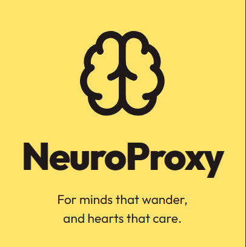
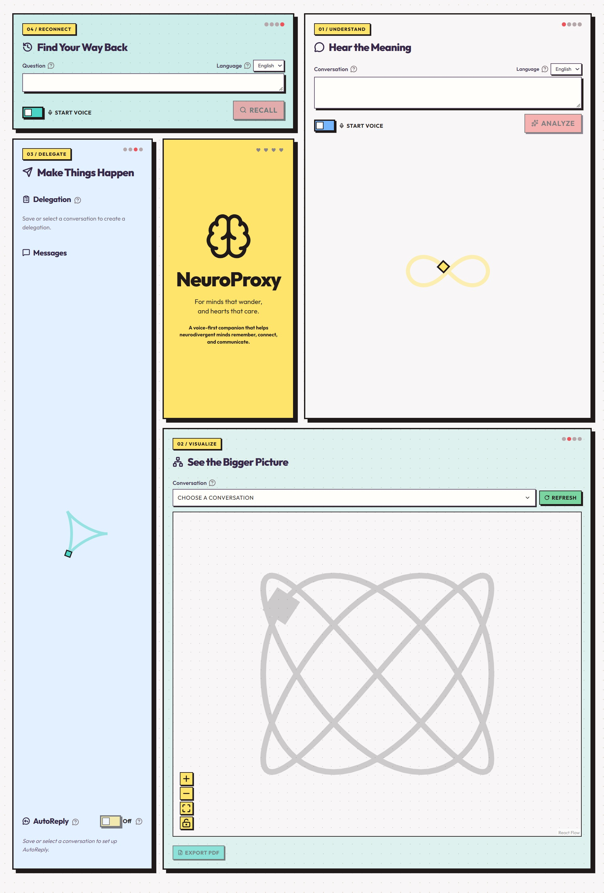
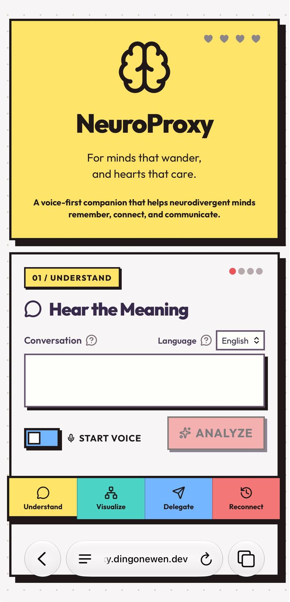
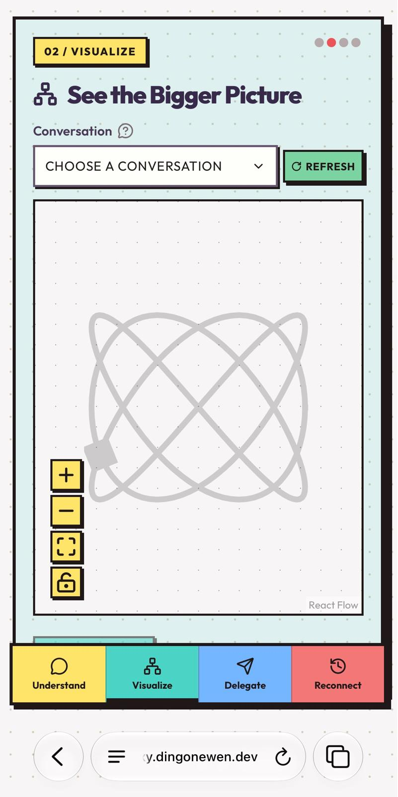
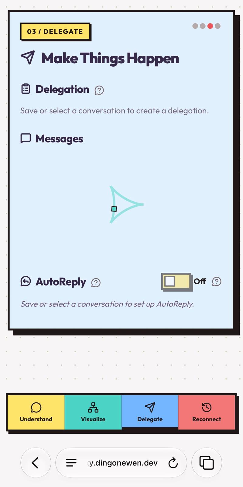
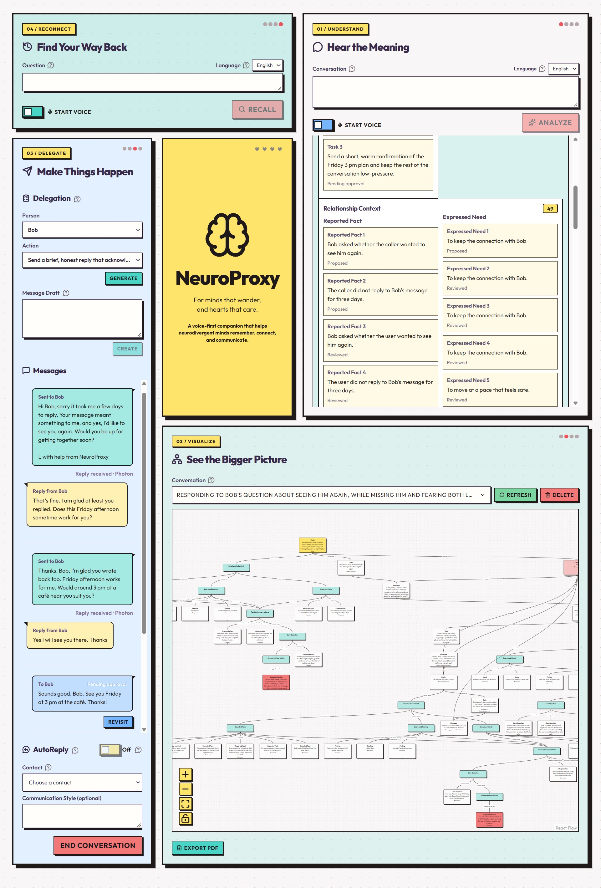
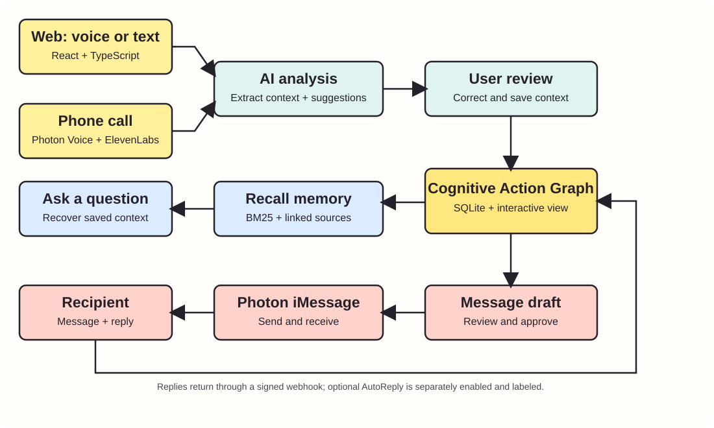

<p align="center"></p>

<h1 align="center">NeuroProxy</h1>

<p align="center"><strong>For minds that wander, and hearts that care.</strong></p>

NeuroProxy is a voice-first companion that helps neurodivergent people remember, connect, and communicate. It turns a conversation into a reviewable Cognitive Action Graph, helps its user take a next step through iMessage, and remembers the context when a reply comes back.

I built NeuroProxy from my own experience with ADHD: I can care deeply about someone and still lose track of what they said, miss a message, or struggle to find the words to reply. I want the people around me to know that even when my mind wanders, my heart cares. [Read the project vision](docs/VISION.md).

NeuroProxy is an accessibility and communication aid, not a medical device. It does not diagnose or treat a condition.

<p align="center"></p>

*The four-part workspace brings understanding, visualization, action, and recall together.*

## From a conversation to a connection

Imagine telling NeuroProxy that you want to reconnect with a friend but are unsure how to respond. The prototype supports a complete loop:

1. **Hear the Meaning.** Type, speak in a supported browser, or call the Photon voice number. The agent extracts people, tasks, open questions, reported facts, feelings, and possible interpretations. You review and correct its suggestions.
2. **See the Bigger Picture.** Save the reviewed context as a persistent, interactive Graph. Explore its connections, select nodes, and export the Graph. The relationship headers indicate review order; they do not prove causation.
3. **Make Things Happen.** Choose an action and a recipient, generate or edit a draft, and explicitly approve a real iMessage. A reply returns through Photon and can be analyzed to help you prepare the next message. An independently enabled, experimental AutoReply can respond without approval for each message and identifies itself as automated.
4. **Find Your Way Back.** Ask a question about saved context or message history. A read-only memory tool retrieves relevant Graph records and can show sources that link back to the Graph. Supported browsers can read the answer aloud.

The desktop and mobile web interfaces share this workflow. On mobile, colored tabs and horizontal swipes switch sections while the Graph retains its own gestures. Neither a native iOS app nor a second phone is required for the developer's test setup.

<p align="center">
  
  
  
</p>

<p align="center"></p>

*A conversation in progress: reviewed context, messages, and the Graph stay together.*

## Why this is an agent

NeuroProxy combines AI interpretation with application-controlled tools and state:

| Capability | How the prototype uses it |
| --- | --- |
| **Reason and plan** | Model-backed analysis separates reported facts, feelings, and possible interpretations, then proposes actions and drafts for review. |
| **Act** | An approved delegation becomes a real Photon iMessage. Incoming webhook events are matched to saved context so a reply can inform the next step. |
| **Remember** | A persistent Graph stores reviewed context, messages, and reply progress. The read-only `recall_memory` tool uses local BM25 to select a bounded set of relevant records for a question. |
| **Adapt to context** | Later drafts and recovery can use saved context and the user's edits; AutoReply can use a user-entered communication preference. The prototype does **not** train a personal model or automatically learn a personality. |
| **Keep the user in control** | Ordinary messages require explicit approval. AutoReply is off by default, is authorized separately, and labels each automatic message. |

This is a practical accessibility workflow built around a real personal need, not a claim of measured clinical effectiveness or a completed user study. More about the design and longer-term direction is in [Vision](docs/VISION.md) and [Decisions](docs/DECISIONS.md).

## Architecture

The diagram follows a conversation from voice or text through AI analysis and the Graph, then into approved Photon messaging and read-only memory retrieval.



The web app uses React, TypeScript, React Flow and Vite. The TypeScript backend uses Fastify, Mastra-powered model calls and SQLite. Structured outputs are validated before saving; message authorization, webhook verification, matching, state transitions and duplicate-send handling are controlled by application logic rather than left to the model.

**Memory:** `recall_memory` retrieves a bounded set of Graph nodes and nearby message links; the server checks cited IDs against retrieved records before displaying source links. That validates the IDs, not whether every claim is supported by its citation. Retrieval can miss relevant context, particularly with different wording; no-match queries fall back to recent nodes. Verify important answers against Messages. This tool and source-link UI have automated coverage but still need a live end-to-end check.

**Insight deduplication:** Initial extraction uses lexical similarity to limit repeated insights. Reply analysis can optionally use Cloudflare Workers AI BGE-M3 embeddings for same-category comparisons; Chinese text and provider errors fall back to lexical matching. Embeddings are held in memory, not saved. This is not a vector database or semantic memory retrieval, and the Cloudflare integration has not yet been verified against a live account.

## What works today

| Capability | Status |
| --- | --- |
| Approved iMessage and incoming reply | Manually tested with the developer's iPhone, including reply analysis and follow-up. |
| AutoReply | One relevant real iMessage AutoReply was manually verified. The off switch, opt-out and disclosure still need separate live verification. |
| Inbound phone voice | A Photon-to-ElevenLabs call produced a reviewable Graph. |
| Outbound phone voice | An ElevenLabs test call through Photon connected. Caller ID, two-way audio and call termination have not been separately verified. The app has no outbound call control yet. |
| Graph export and mobile interface | PDF content and mobile navigation were manually reviewed; the PDF's visual presentation can improve. |
| Recall sources and Cloudflare embeddings | Automated coverage exists; live provider and UI verification remains. |
| SMS messaging | Not verified; campaign registration remains unresolved. SMS is not exposed as a sending option in the demo UI. |

Photon accepting a send request is not confirmation that it was delivered. Automated tests and simulated messages complement the real tests above; simulations must not be presented as real delivery. See the [checklist](docs/CHECKLIST.md) for remaining work.

## Photon, approval and AutoReply

NeuroProxy uses Photon 2.0 for iMessage and for the SMS-number voice channel. A shared iMessage line requires the recipient to be assigned a shared-line number and to message it first; assignment does not imply consent. The app stores contacts locally; it does not import the phone's address book. After choosing a contact, it matches the most recently received iMessage conversation for that address. Check the recipient and message, confirm consent, and choose **Approve & Send Message**. See [Photon's iMessage guide](https://photon.codes/docs/beta/get-started/imessage).

AutoReply is a separate experimental authorization for an eligible contact within a saved conversation, after an approved iMessage has been sent. When enabled, it can send subsequent replies without individual approval. Every automatic message begins with `[NeuroProxy AutoReply]`. Ambiguous matches remain for manual review. Recognized stop-contact requests disable AutoReply, but simple matching cannot recognize every wording. A repeated previous message triggers one revision attempt; if it still repeats or no reply is suggested, the job stops for review. An uncertain send is not automatically retried; an already submitting message may not be stopped by switching AutoReply off. Test only with consenting participants, and do not rely on unverified behavior.

Configure `PHOTON_API_KEY`, `PHOTON_PROJECT_ID` and `PHOTON_WEBHOOK_SECRET`. `npm run check:photon` checks project access read-only; it does not verify delivery or webhook setup. Subscribe a Photon destination to `message.received` and route it over HTTPS to `POST /api/webhooks/photon`. The backend verifies the signature and timestamp, ignores duplicate webhook deliveries, and links matched replies; uncertain matches require confirmation. If a send outcome is unknown, check Photon before sending again.

## Voice

Browser speech recognition can capture text in **Hear the Meaning** and **Find Your Way Back**. It may send audio to the browser's speech provider. Voice input does not approve or send messages.

For phone calls, Photon routes an eligible SMS number over SIP to ElevenLabs. With the caller's permission, the agent calls the protected `POST /api/voice/capture` tool to create a proposed Graph and possibly a draft for web review. It cannot approve or send messages. The bridge currently saves at most one Graph per call; the tool bearer token authenticates ElevenLabs, **not the caller**. Phone access to saved context, voice approval, automatic call-to-text continuity, and asynchronous voice messages are not implemented. An outbound test can be initiated from ElevenLabs through the configured Photon SIP trunk; it is not yet controlled from NeuroProxy. A shared iMessage line cannot receive calls.

To configure the phone bridge:

1. Set a unique random `VOICE_TOOL_SECRET` of at least 32 characters in `.env` and restart the backend. Store the same value as an ElevenLabs secret, never in a prompt, URL, or source control.
2. Configure the Photon SMS number and ElevenLabs agent for inbound SIP using [Photon's voice guide](https://photon.codes/docs/beta/get-started/voice).
3. Expose only `/api/voice/capture` and `/api/webhooks/photon` over HTTPS. **Do not expose the rest of `/api`**: the local API has no general authentication.
4. Configure an [ElevenLabs webhook tool](https://elevenlabs.io/docs/eleven-agents/customization/tools/webhook-tools) to POST JSON with a bearer token from its secret store. Bind `conversationId` to `system__conversation_id` and provide a concise caller-approved `text` parameter of at most 8,000 characters.
5. Instruct the agent to ask before capturing, summarize only the tool's result, and explain that the Graph and draft require review. It must not claim that a message was sent.

## Run locally

Requirements: Node.js 24 or newer and npm.

```bash
npm install
cp .env.example .env
# If ElevenLabs onboarding has not already created this file:
touch .env.local
npm run dev
```

In a second terminal:

```bash
npm run dev:web
```

Fill in the required model credentials in `.env`, plus the Photon and voice settings for the features you use. ElevenLabs onboarding stores its API key in ignored `.env.local`. Never commit secrets or put real credentials in `.env.example`. Restart the backend after changing its configuration or code. Open the Vite URL printed by the frontend command. SQLite defaults to `neuroproxy.db`; `NEUROPROXY_DB` can select another path.

```bash
npm test
npm run build
```

For private phone access, use a separate HTTPS hostname protected by Cloudflare Access and restricted to your account. Set `NEUROPROXY_WEB_HOST` to that exact hostname, restart Vite, and route the hostname through the tunnel to `http://127.0.0.1:5173`. Keep provider webhook routes separate and path-restricted. Vite's allowed-host setting is not authentication. The laptop and tunnel must remain running.

### Public interactive preview

Run `npm run build:preview` to create a separate static site in `dist-preview/`. Upload the contents of that folder to a static host, such as Cloudflare Pages. This build displays a preview notice, returns an empty graph locally, blocks application requests, and disables browser voice recognition; AI, saving and messaging do not work. A preview-only Content Security Policy blocks network connections as a second layer. Text typed into the interface is held in the page and cleared on reload. Deploy the static output only, never `.env`, the database, or the backend.

### Deployment scope

The public preview and the working agent are separate experiences:

| Mode | Purpose | Availability |
| --- | --- | --- |
| Public static preview | Explore the desktop/mobile UI without AI calls or real messages. | Independent of the developer's laptop once uploaded. |
| Private working demo | Use analysis, saved memory, approved iMessage and AutoReply. | The local backend, frontend and HTTPS tunnel must remain running; laptop sleep or a stopped process interrupts the workflow. |
| Future hosted agent | Receive messages and run authorized AutoReply while the laptop is offline. | Requires a production deployment; this repository does not yet include a complete production deployment configuration. |

For a hosted agent, serve the production frontend build and proxy `/api` to the Node backend on the same origin. The current frontend proxy is a Vite development setting, and the backend currently binds to `127.0.0.1:3000`; hosting must account for those settings. Use a persistent volume for `NEUROPROXY_DB`, keep the agent on a single backend instance initially, back up SQLite, and store provider credentials in the host's secret configuration. Protect user-facing APIs with authentication and add usage limits before granting public access. Provider callbacks need separately reachable routes with their existing signature or bearer-token verification. Moving only the frontend to a static host does not make the agent available while the laptop is offline.

### Demo troubleshooting

| Symptom | Check and recovery |
| --- | --- |
| A phone reply does not appear in the selected conversation | Check the unlinked messages in the Graph conversation selector. Multiple waiting delegations for the same Photon conversation can make matching ambiguous. Select the reply node, choose its delegation and use **Confirm this is a reply**. |
| **Confirm Reply** appears below an incoming message | The match is provisional. Confirm it to continue analysis, or choose **Not a Reply** to leave it unlinked. |
| Recipient consent checkbox is disabled after saving a contact | A contact record alone is insufficient: a matching received iMessage session must exist. If deleting old conversations removed the last session, ask the consenting recipient to send a **new** iMessage to the assigned Photon number, then reload the page. |
| The local page or API will not start | Run commands from the repository directory. The backend uses port 3000; Vite uses 5173 with `strictPort`, so it fails rather than silently moving to a different port. Check for an existing instance before restarting. |

Success confirmations disappear after 10 seconds. Errors, loading indicators and actionable message states remain visible. Deleting local history does not undo messages on the recipient's phone; preserve any context you need before resetting a demo.

## Privacy and limits

Analysis, drafting, reply analysis, and recovery send relevant entered or saved context to the configured AI provider. If enabled, Cloudflare Workers AI also receives the insight text being compared for deduplication. The voice provider receives call audio and the account submitted to its capture tool. Browser speech recognition can use an external speech provider. These are external services, not a private training sandbox.

Local SQLite stores conversations, contacts and message records. Deleting a conversation removes its associated local Graph, drafts and message records, but not messages already sent through Photon or present on recipients' devices; contacts remain. Hashed event identifiers remain to prevent replaying deleted incoming events. Transcripts from the retired voice-note feature, if any, remain in the `voice_notes` table. Use synthetic data for demonstrations where practical.

Optional OpenTelemetry/Logfire tracing exports allowlisted diagnostic metadata such as status and timing, not intentionally conversation content, contacts, credentials or raw provider errors. Configure `LOGFIRE_TOKEN` and optionally `LOGFIRE_BASE_URL`; without a token, traces are not exported. Live Logfire export remains to be verified.

Further technical details are in [Implementation](docs/IMPLEMENTATION.md). The Coral theme, BoldKit curve adaptations and other dependencies are documented in [Third-party notices](THIRD_PARTY_NOTICES.md) and the [BoldKit license](THIRD_PARTY_LICENSES/boldkit.txt).
